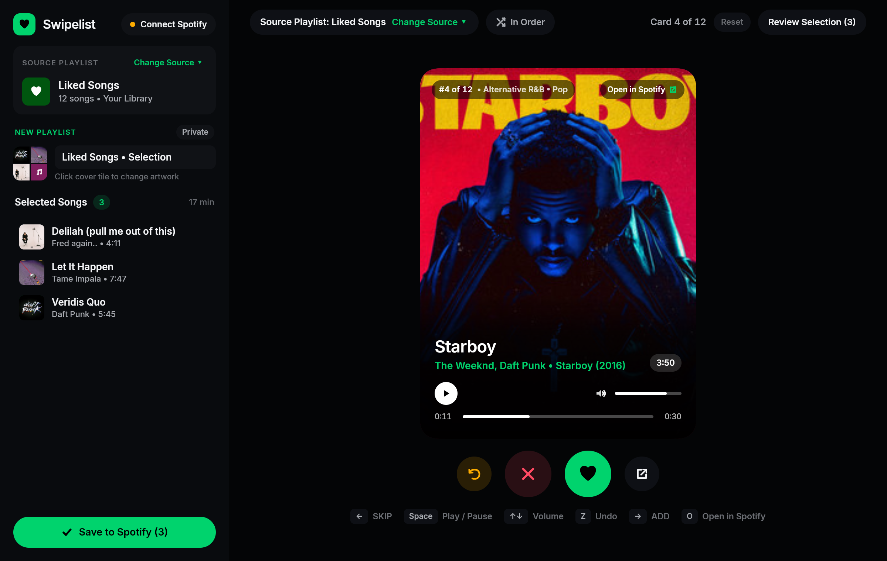
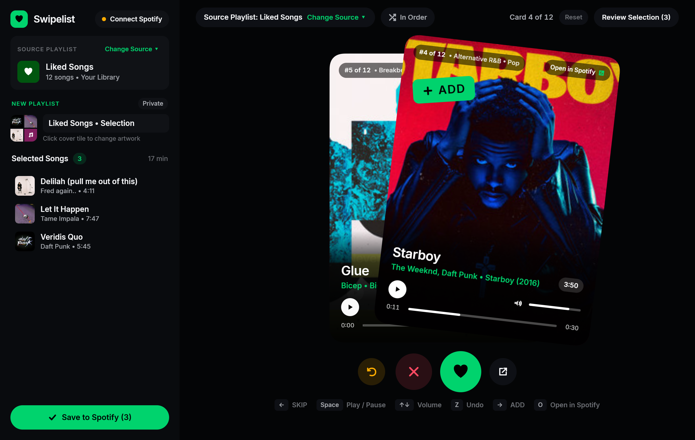
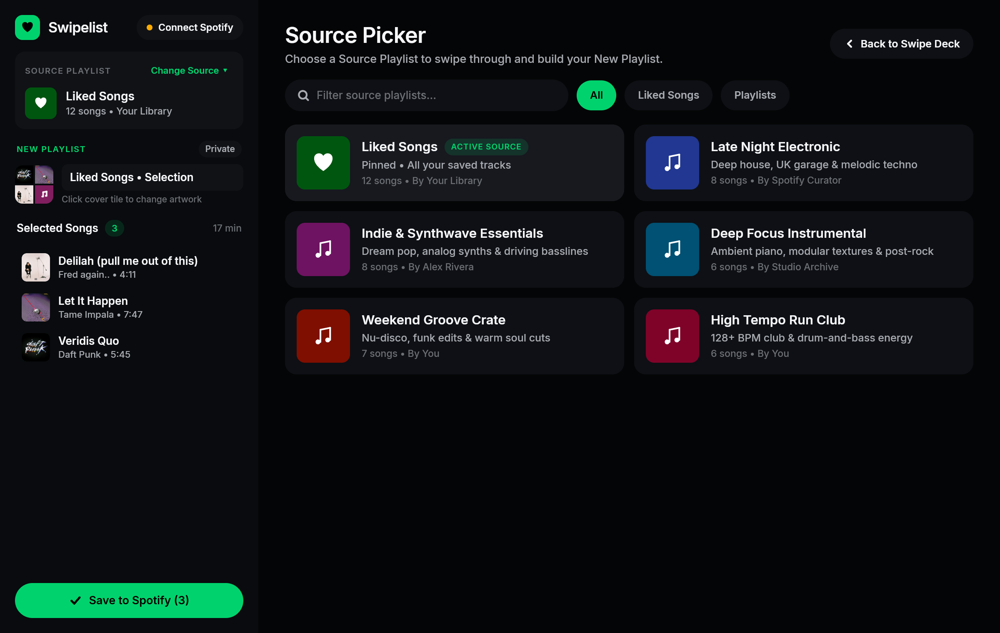
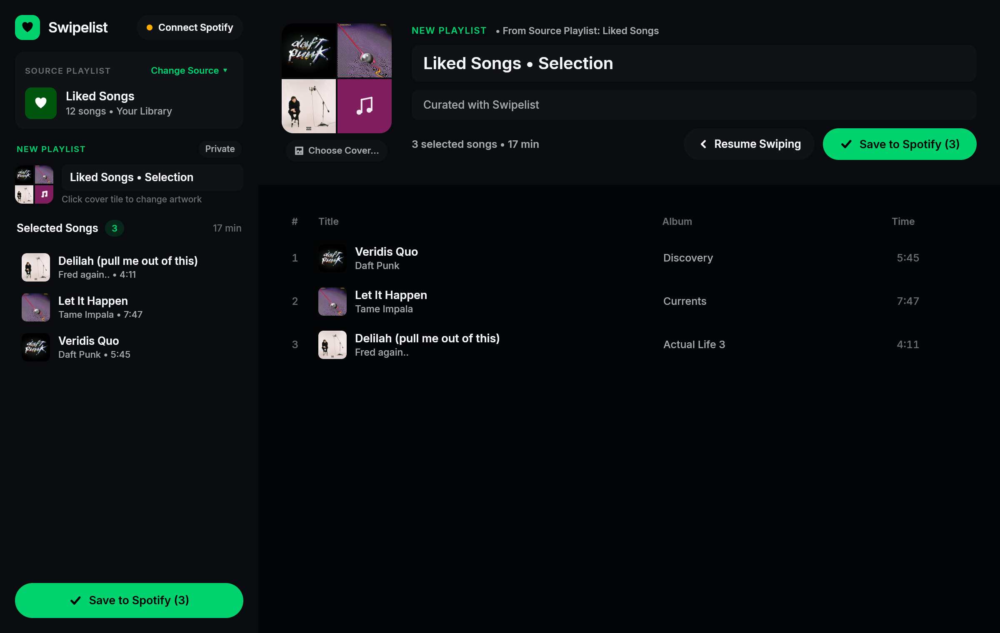
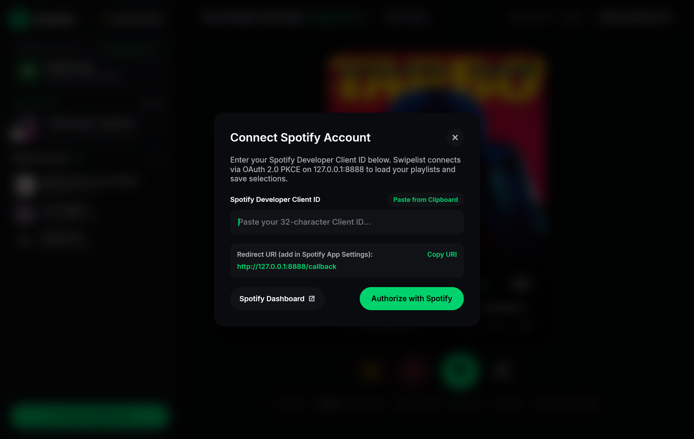
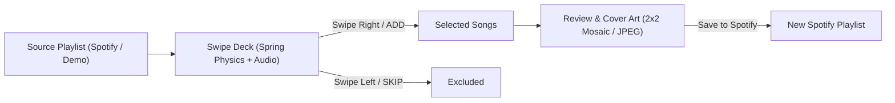

<div align="center">
  
  <h1>Swipelist</h1>
  <p><strong>A native, GPU-rendered Tinder-style Spotify playlist curator built in pure Rust.</strong></p>

  <p>
    
    
    
    
  </p>

  <p>
    <a href="#features">Features</a> •
    <a href="#screenshots">Screenshots</a> •
    <a href="#tech-stack">Tech Stack</a> •
    <a href="#getting-started">Getting Started</a> •
    <a href="#controls">Controls</a> •
    <a href="#architecture">Architecture</a>
  </p>

  <br />
  
</div>

---

## Features

- **Fluid Swipe Deck** — 1:1 spring-physics card dragging, velocity-projected flicks, tilted `ADD` / `SKIP` stamps, and instant undo.
- **Embedded Audio Preview Player** — In-card play/pause, draggable seek scrubber, perceptual volume curve + mute, and local MP3 caching.
- **Full-Library Curation** — Browse *Liked Songs* and all Spotify playlists with full pagination, search/filtering, and Fisher-Yates shuffle (with original-order restore).
- **Custom Playlist Export** — Customize title, description, privacy (`Private` / `Public`), and cover art (automatic PNG/JPG resize & JPEG encoding within Spotify's 256 KB limit).
- **Auto-Saved Sessions** — Automatically persists swipe progress and selection in `%APPDATA%\swipelist\swipelist_progress.json` (Windows) or `$HOME/swipelist/swipelist_progress.json` (Unix).
- **Direct OAuth 2.0 PKCE** — Connects directly to Spotify with OS CSPRNG PKCE (`BCryptGenRandom` / `/dev/urandom`), mandatory CSRF `state` verification, HTTPS-only requests, and automatic token refresh — zero backend servers.

---

## Screenshots

<table>
  <tr>
    <td align="center" width="50%">
      
      <br />
      <sub><strong>Swipe Gesture (ADD)</strong></sub>
    </td>
    <td align="center" width="50%">
      
      <br />
      <sub><strong>Source Playlist Picker</strong></sub>
    </td>
  </tr>
  <tr>
    <td align="center" width="50%">
      
      <br />
      <sub><strong>Review &amp; Cover Customization</strong></sub>
    </td>
    <td align="center" width="50%">
      
      <br />
      <sub><strong>OAuth 2.0 PKCE Setup</strong></sub>
    </td>
  </tr>
</table>

---

## Tech Stack

| Layer | Technologies | Role |
|---|---|---|
| **Core & Language** |  | Memory-safe systems language with zero runtime or Electron overhead |
| **UI & GPU Rendering** |    | Keyed element trees, analytic spring motion, native audio playback, and hardware-accelerated rendering |
| **Layout & Text** |   | Pixel-snapped Flexbox layout, glyph shaping, and crisp text rasterization |
| **API, Auth & Media** |     | Direct Spotify REST integration, OS CSPRNG PKCE authentication, state persistence, and cover art transcoding |

---

## Getting Started

### Prerequisites

- **Rust toolchain** (Edition 2024) via [rustup](https://rustup.rs/)
- **`curl`** available on `PATH` (pre-installed on Windows 10/11, macOS, and most Linux distributions)
- **Spotify Developer Client ID** *(optional — built-in starter playlists work offline right out of the box)*

### Build & Run

```bash
git clone https://github.com/kengxiang1/swipelist.git
cd swipelist
cargo run --release
```

### Spotify API Setup

1. Open the [Spotify Developer Dashboard](https://developer.spotify.com/dashboard) and create an application.
2. Under **Redirect URIs**, add:
   ```text
   http://127.0.0.1:8888/callback
   ```
3. Launch Swipelist, click **Connect Spotify**, paste your **Client ID** (or set `SPOTIFY_CLIENT_ID` in your environment), and click **Authorize with Spotify**.

---

## Controls

| Action | Pointer | Keyboard |
|---|---|---|
| **Add track** | Drag card right or click **ADD** (`♥`) | `→` |
| **Skip track** | Drag card left or click **SKIP** (`✕`) | `←` |
| **Play / Pause & Seek** | Click `▶` / `⏸` or drag the seek bar | `Space` |
| **Volume / Mute** | Drag volume slider or click speaker icon | `↑` / `↓` |
| **Undo** | Click **Undo** (`↺`) | `Z` / `Backspace` |
| **Open in Spotify** | Click **Open in Spotify** (`↗`) | `O` |
| **Back / Close Modal** | Click **Back** or modal backdrop | `Esc` |

---

## Architecture



### Project Layout

| Path | Purpose |
|---|---|
| [`src/main.rs`](src/main.rs) | Application state, spring-physics swipe deck, audio preview controls, and multi-screen Rune views |
| [`src/spotify.rs`](src/spotify.rs) | OAuth 2.0 PKCE flow, HTTPS-validated Spotify Web API client, disk caches, JPEG cover encoder, and progress store |
| [`src/icons.rs`](src/icons.rs) | Vector icons and procedural vinyl artwork rendered via Rune's GPU `Shape` primitive |
| [`assets/`](assets/) | Application icon, Windows resource definition, and README preview screenshots |
| [`crates/rune`](crates/rune) | Vendored pure-Rust GPU-rendered UI framework (`wgpu`, `winit`, Taffy layout, analytic springs, and headless tooling) |

<details>
<summary><strong>Development, Testing &amp; Headless Snapshots</strong></summary>

### Tests & Linting

```bash
# Run unit tests
cargo test -p swipelist

# Run Clippy checks on the application crate
cargo clippy --no-deps -p swipelist --all-targets
```

### Headless Snapshots & Layout Tree

Render any screen headlessly on the GPU or inspect the accessibility/layout tree without opening a window:

```bash
# Render screenshots of specific screens
cargo run -- --snap swiping.png --scene swiping
cargo run -- --snap review.png --scene review

# Dump the accessibility & layout element tree as JSON
cargo run -- --tree --scene swiping
```

Available `--scene` presets: `swiping`, `drag-add`, `drag-skip`, `source-picker`, `review`, `saved`, `auth-modal`.

</details>

---

## License

Released under the [MIT License](Cargo.toml).
